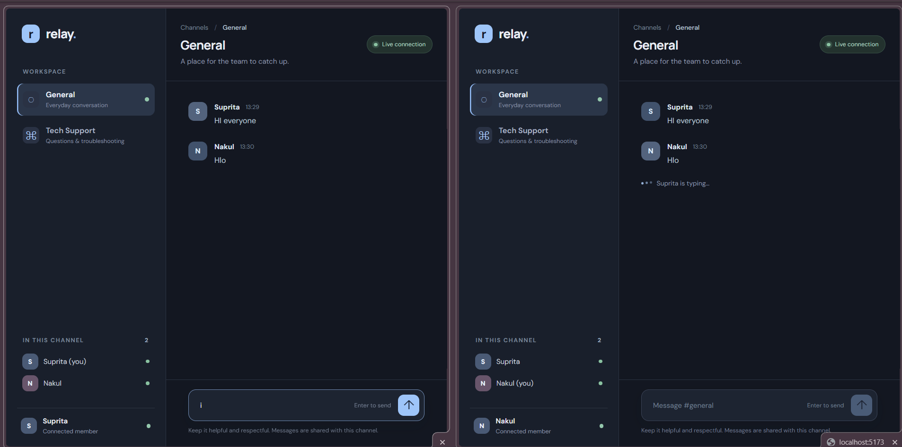

# Real-Time Chat — Track B

A small full-stack chat application built with React, Vite, Express and Socket.IO. It demonstrates persistent WebSocket connections, session identity, room-based messaging and live typing indicators.

## 🚀 Live Demo
👉  Live Website:(https://com-room.vercel.app/)

---
📸 Project Screenshot
### Desktop Preview


## Features

- React client connects to an Express/Socket.IO server.
- Users enter a display name before joining.
- Two isolated channels: **General** and **Tech Support**.
- Messages are sent to everyone else in the selected room (the sender is not echoed back).
- New messages show the sender's session identity, e.g. `[Nakul]: Hello!`.
- Typing events are broadcast to other members of the same room.
- Active users in the selected room are listed in the sidebar.
- Connection state and server errors are visible in the UI.
- Socket listeners and the connection are cleaned up on unmount.
- Socket.IO CORS is configured separately from Express HTTP CORS.

## Requirements

- Node.js 18.18+ (Node.js 20 LTS recommended)
- npm

## Project structure

```text
realtime-chat-socketio/
├── backend/
│   ├── src/
│   │   ├── config.js
│   │   ├── socket.js
│   │   └── server.js
│   ├── .env.example
│   └── package.json
├── frontend/
│   ├── src/
│   │   ├── components/
│   │   │   ├── ChatHeader.jsx
│   │   │   ├── MessageList.jsx
│   │   │   ├── Sidebar.jsx
│   │   │   └── UserPrompt.jsx
│   │   ├── App.jsx
│   │   ├── main.jsx
│   │   ├── socket.js
│   │   └── styles.css
│   ├── .env.example
│   ├── index.html
│   └── package.json
├── .gitignore
└── PROMPTS.md
```


